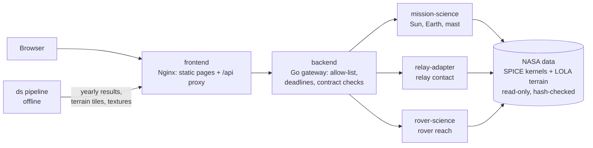

# Skyline

Skyline compares lunar landing sites and dates by drawing where the Sun and Earth sit against each site's real terrain horizon. From that one picture it answers two questions a lunar mission has to settle before landing:

- **Is there sunlight?** How much of the time the Sun clears the skyline, which sets a lander's solar power potential.
- **Can it see Earth?** When Earth is above the skyline, which sets the windows for direct-to-Earth communication.

It also measures how much a relay satellite shortens the communication gaps that remain, and where a rover or a solar mast would do better.

## Why we built it

Team Hexakong built Skyline for a NASA hackathon challenge. The challenge asked for:

> An intuitive tool that lets mission planners, educators and the public compare landing sites and dates quickly, showing Sun and Earth positions relative to the horizon to assess power generation potential and direct-to-Earth communication windows.

The south pole is where this gets hard. The Moon's axis tilts only about 1.54° to the ecliptic, so at the pole the Sun skims the horizon, and a ridge 100 km away decides whether a site is lit. [docs/solution/concept.md](docs/solution/concept.md) explains the problem in full. [docs/product/requirements.md](docs/product/requirements.md) maps every part of the challenge to what the app does.

## Manuscript

The method behind Skyline is written up in our manuscript:

> Daffa Tarigan, Mohammad Ezzeddin Pratama, Paulus Billiardo Putrakedua, Louis Enggar Theo Dharma, Caroline Felicia, and Celine Stacia Tanijar (2026). *SKYLINE: A Terrain-Aware Computational Framework for Lunar South-Pole Illumination, Communication, and Mission Planning*. Unpublished manuscript. https://doi.org/10.13140/RG.2.2.13417.66404

To cite Skyline, use this BibTeX entry:

```bibtex
@article{skyline2026,
	title     = {SKYLINE: A Terrain-Aware Computational Framework for Lunar South-Pole Illumination, Communication, and Mission Planning},
	author    = {{Daffa Tarigan} and {Mohammad Ezzeddin Pratama} and {Paulus Billiardo Putrakedua} and {Louis Enggar Theo Dharma} and {Caroline Felicia} and {Celine Stacia Tanijar}},
	year      = {2026},
	publisher = {Unpublished},
	doi       = {10.13140/RG.2.2.13417.66404},
	url       = {https://doi.org/10.13140/RG.2.2.13417.66404}
}
```

## What's in the app

| Page | Path | What it does |
| --- | --- | --- |
| Home | `/` | Asks what brings you to the Moon, and sends each audience to its page |
| Explore | `/explore` | For the curious: fly from the whole Moon down to a polar ridge, and see why a few metres change everything |
| Understand | `/understand` | For classrooms: predict, move the Sun through a lunar day, and explain what the terrain hides |
| Analyze | `/analyze` | For mission planners: compare sites and landing dates against your own Sun and Earth requirements, then add a relay, rover or mast |
| Sites | `/sites` | Lists all 13 sites, from Skyline's south-pole rims to other agencies' landings |
| Method | `/method` | States how every number is computed, and its limits |

Skyline covers two kinds of site:

- **Three south-pole study sites** (Connecting Ridge, de Gerlache Rim, Shackleton Rim), plus Apollo 11 and Shackleton connecting ridge for comparison. These sites have a full precomputed year on the 80 m polar terrain map.
- **Other agencies' landings**: Chang'e-4 and Chang'e-6 (CNSA), Chandrayaan-3 (ISRO), SLIM (JAXA), and Luna-25 (Roscosmos). These sites are computed on request from NASA's global terrain map at about 1.9 km spacing. Small ridges are missed at that spacing, so the app labels these results exploratory.

Every result is a geometric opportunity: the Sun or Earth is above the terrain. It does not promise delivered power, a working radio link, or guaranteed contact. [docs/science/claims.md](docs/science/claims.md) sets out exactly what the app may and may not claim.

## How it fits together

| Part | Path | Built with | Job |
| --- | --- | --- | --- |
| Web app | `frontend/` | TanStack Start, React, Tailwind CSS v4, Three.js, Vite | Every page. Pre-rendered to static files. |
| API gateway | `backend/` | Go | Routes `/api/*` requests to the science services. |
| Mission science | `services/missionScience/` | Python, FastAPI, SPICE | Computes Sun and Earth visibility, mast power and placement, and rover reach on request. |
| Relay adapter | `services/relayAdapter/` | Python, FastAPI | Computes relay satellite contact from a pinned orbit trajectory. |
| Science pipeline | `ds/` | Python 3.12, uv | Precomputes the yearly results, terrain tiles and textures the app ships with. |
| ML service | `ml/` | Python | A placeholder that returns `stub_only`. Nothing in the app depends on it. |
| Contracts | `contracts/` | JSON Schema | The request and response formats every part agrees on. |

## System design

Skyline is static first. Every baseline number is computed ahead of time by the pipeline and shipped with the app as JSON, so the pages work with no server running. Live requests go through one gateway to the science services:



The south-pole study sites run on the 80 m polar terrain and support every add-on. The other agencies' landing sites run on the 1.9 km global terrain and support the live check only.

[docs/architecture/system-design.md](docs/architecture/system-design.md) is the full design, in 14 diagrams: containers, the gateway routing table, each live request in sequence, the data pipeline, the frontend structure, the contracts, deployment, and how each site is routed to its terrain.

## How the engine calculates

For each site and moment, the scientific engine answers one question: is the Sun or Earth above the terrain? It works in six steps:

1. **Place the observer** on the Moon's 1 737.4 km reference sphere, at the terrain height under the site plus 2 m.
2. **Build the skyline:** the highest terrain elevation in each of 1 440 azimuth sectors (0.25° each), searched out to 400 km on the NASA LOLA terrain maps.
3. **Track the Sun and Earth** with NASA JPL SPICE (DE440 ephemeris, `MOON_ME_DE421` frame), as azimuth and elevation seen from the site.
4. **Compare:** the clearance is the body's elevation minus the skyline in its sector. For the Sun, the visible part of the disk comes from the circular-segment area.
5. **Find events:** every sunrise, sunset, earthrise, earthset and grazing pass is solved to 1 s with Brent's method.
6. **Summarise:** sunlight and Earth availability, the longest darkness, the longest Earth blackout, and full provenance. Every input file is identified by its SHA-256 hash.

The mast, rover and relay add-ons reuse the same calculation, for a raised observer, a grid of rover cells, or a relay satellite in place of Earth.

[docs/science/engine.md](docs/science/engine.md) gives every formula, with its source file and line, the tests that check each step, and the engine's stated limits.

## Prerequisites

| Tool | Version | Needed for |
| --- | --- | --- |
| Docker with Compose | Compose v2.20 or later | The quickest way to run everything |
| Node | 24 | The web app |
| pnpm | 11.22.0 (run `corepack enable` to get it) | The web app |
| Go | 1.24 | The API gateway, outside Docker |
| Python | 3.12 | The science services, outside Docker |
| uv | 0.11 or later | The science pipeline |
| wget or curl | any recent | Downloading NASA data |

You need about 500 MB of disk space for the NASA data, and more for the Docker images.

## Run it

Pick the path that matches what you want to see.

### See the app with no downloads

The yearly results for the study sites are committed under `frontend/data/`, so the app runs without any NASA data. Live checks and the international sites need the science services, which need the data in the next section.

```sh
cd frontend
pnpm install
pnpm dev
```

Open http://localhost:5173. Pages that ask the science services for a live result show that the service is unavailable.

### Run the full app with live science

1. Download the NASA data. The next section lists every file.
2. Check the downloads against their pinned hashes:

	```sh
	python3 scripts/prepareScienceAssets.py --global-terrain
	```

	The script prints `Verified 11 pinned scientific assets`. Leave out `--global-terrain` if you skipped the global terrain files. In that case it verifies 9.

3. Build and start every service:

	```sh
	docker compose up -d --build
	```

4. Open http://localhost:8080.

To work on the frontend with hot reload against the live services, keep Docker running and start `pnpm dev` in `frontend/`. The dev server on http://localhost:5173 sends `/api` requests to `http://127.0.0.1:8080`. To send them elsewhere, set `BACKEND_URL`.

If you change backend or service code, run `docker compose up -d --build` again. The running containers keep serving the old code until you rebuild them.

## Download the NASA data

The science services read NASA SPICE kernels for the positions of the Sun, Earth and Moon, and NASA LOLA terrain maps for the horizon. These files are too large for git. They live in `services/missionScience/data/raw/`, which git ignores, and `prepareScienceAssets.py` checks each one against the SHA-256 hash pinned in [services/scienceAssets.manifest.json](services/scienceAssets.manifest.json).

Run these commands from the repository root.

**SPICE kernels** (45 MB, from NASA JPL NAIF):

```sh
K=https://naif.jpl.nasa.gov/pub/naif/generic_kernels
D=services/missionScience/data/raw/spice
wget -c -P $D $K/lsk/naif0012.tls
wget -c -P $D $K/spk/planets/de440s.bsp
wget -c -P $D $K/pck/pck00011.tpc
wget -c -P $D $K/pck/moon_pa_de421_1900-2050.bpc
wget -c -P $D $K/pck/moon_pa_de440_200625.bpc
wget -c -P $D $K/fk/satellites/moon_080317.tf
wget -c -P $D $K/fk/satellites/moon_de440_250416.tf
```

**South-pole terrain** (408 MB, from NASA Goddard PGDA LOLA product 90):

```sh
L=https://pgda.gsfc.nasa.gov/data/LOLA_20mpp
D=services/missionScience/data/raw/lola
wget -c -P $D $L/LDEM_80S_80MPP_ADJ.TIF
wget -c -P $D $L/LDEM_60S_240MPP_ADJ.TIF
```

**Global terrain** (33 MB, from the LOLA archive at MIT). The international sites need these two files:

```sh
G=https://imbrium.mit.edu/DATA/LOLA_GDR/CYLINDRICAL/IMG
D=services/missionScience/data/raw/lola
wget -c -P $D $G/LDEM_16.IMG
wget -c -P $D $G/LDEM_16.LBL
```

To keep the data somewhere else, set `SKYLINE_MISSION_ASSET_ROOT` to that folder before you run `docker compose`.

If a hash check fails, the upstream file changed, and results can change with it. Find out what changed before you re-pin the hash.

[docs/data/sources.md](docs/data/sources.md) lists every dataset with its citation, and covers the optional higher-resolution maps the pipeline reads.

## Regenerate everything from scratch

The committed results are reproducible. [docs/setup.md](docs/setup.md) rebuilds every generated file from raw data: the yearly site results, the terrain tiles, the Moon textures, the engine feeds, and the schemas. Each step ends with a check.

## Run the tests

```sh
cd frontend && pnpm check && pnpm test
cd backend && go test ./... && go vet ./...
cd ds && uv run python -m pytest -q
cd services/missionScience && uv run python -m pytest -q
cd services/relayAdapter && uv run python -m pytest -q
```

Run each line from the repository root. The mission-science tests need the NASA data. One frontend test times a 28-day rover simulation, so it can fail on a busy machine and pass when you run it again.

## Data and credits

All lunar data comes from NASA:

- **Terrain:** Lunar Orbiter Laser Altimeter (LOLA) on the Lunar Reconnaissance Orbiter, through NASA Goddard's Planetary Geodesy Data Archive (PGDA). Barker et al. 2023, "A New View of the Lunar South Pole from LOLA", *Planet. Sci. J.* 4, 183, [doi:10.3847/PSJ/acf3e1](https://doi.org/10.3847/PSJ/acf3e1).
- **Positions of the Sun, Earth and Moon:** NASA JPL NAIF SPICE generic kernels, DE440.
- **Moon imagery:** the NASA Scientific Visualization Studio CGI Moon Kit, from LROC images by NASA/GSFC/Arizona State University.
- **Landing positions:** each site cites its own source, such as LROC or a published paper. The `/sites` page links every one.

[docs/solution/references.md](docs/solution/references.md) lists every research source behind the app.

## How we used AI

We built Skyline with AI coding assistants, and we want to be clear about where they did and did not contribute.

- **What AI did:** Claude (Anthropic) and Codex (OpenAI) helped write and review code, tests and documentation, and helped with interface design.
- **What AI did not do:** no scientific number in Skyline comes from a language model. Every elevation, sunlight share, Earth window and coordinate comes from the pipeline's own computation on NASA data, or from a cited source. A value we could not compute stays `null` or `not_computed`. Nothing fills the gap.
- **How we checked it:** a person on the team reviewed every change. The engine's tests check each step against exact answers and independent code paths. For example, its Sun and Earth directions match SPICE's own `azlcpo` within 1e-8°, and its skyline over a perfectly smooth sphere matches the exact horizon dip within 1e-4°. The offline pipeline is also checked against outside references: its Sun and Earth directions agree with NASA JPL Horizons within 0.01°, and its terrain height at Apollo 11 matches the published LROC value to within a metre. No result has yet been validated site by site against an independent horizon, and every response says so (`independentlyValidated: false`).

The `ml/` service is a placeholder, not a model, and the app makes no predictions with machine learning.

## Contributing

[CONTRIBUTING.md](CONTRIBUTING.md) sets the rules for results, provenance, and the checks a change must pass. [docs/STATUS.md](docs/STATUS.md) records what is done, what is in progress, and what is open.
