# Skyline system design

Drawn from the code as of 2026-11-15, after the international site catalogue merged (`compose.yaml`, `frontend/nginx.conf`, `backend/*.go`, `services/*/api.py`, `ds/pipeline`, `frontend/src`). Where this disagrees with [overview.md](overview.md), the code wins: overview.md predates the mission-science, relay and rover services.

1. [System context](#1-system-context)
2. [Containers and runtime topology](#2-containers-and-runtime-topology)
3. [Offline data path (static-first)](#3-offline-data-path-static-first)
4. [Gateway routing table](#4-gateway-routing-table)
5. [Live check: scientific evaluation](#5-live-check-scientific-evaluation)
6. [Relay comparison (Go orchestrates two services)](#6-relay-comparison-go-orchestrates-two-services)
7. [Mast power and placement (long-running)](#7-mast-power-and-placement-long-running)
8. [Rover reachability](#8-rover-reachability)
9. [Scenario feed lifecycle](#9-scenario-feed-lifecycle)
10. [Frontend structure](#10-frontend-structure)
11. [Contracts and schema flow](#11-contracts-and-schema-flow)
12. [Deployment: Compose services, volumes, profiles](#12-deployment-compose-services-volumes-profiles)
13. [Planner user journey](#13-planner-user-journey)
14. [Site routing: polar or global terrain](#14-site-routing-polar-or-global-terrain)

---

## 1. System context

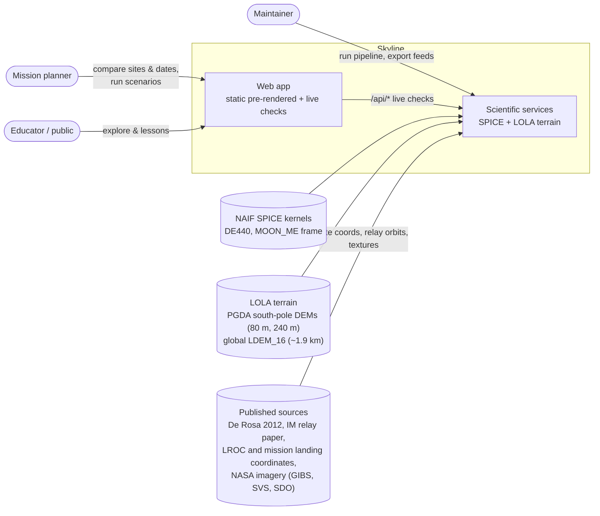

## 2. Containers and runtime topology

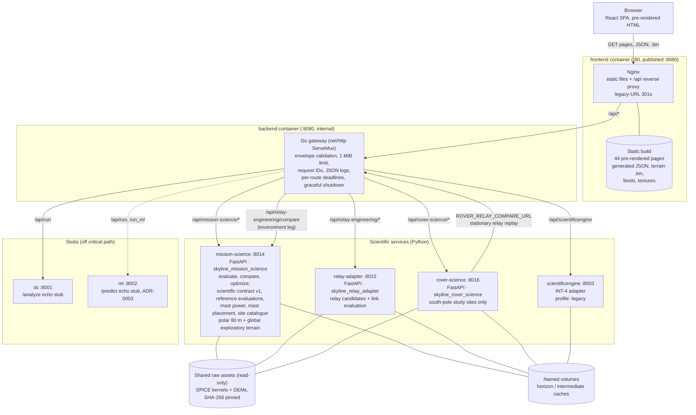

## 3. Offline data path (static-first)

The default path ([ADR-0001](../decisions/0001-static-first-hybrid-architecture.md)): the site works with no server running, because every baseline number is computed ahead of time.

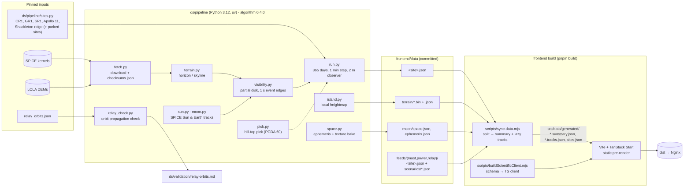

## 4. Gateway routing table

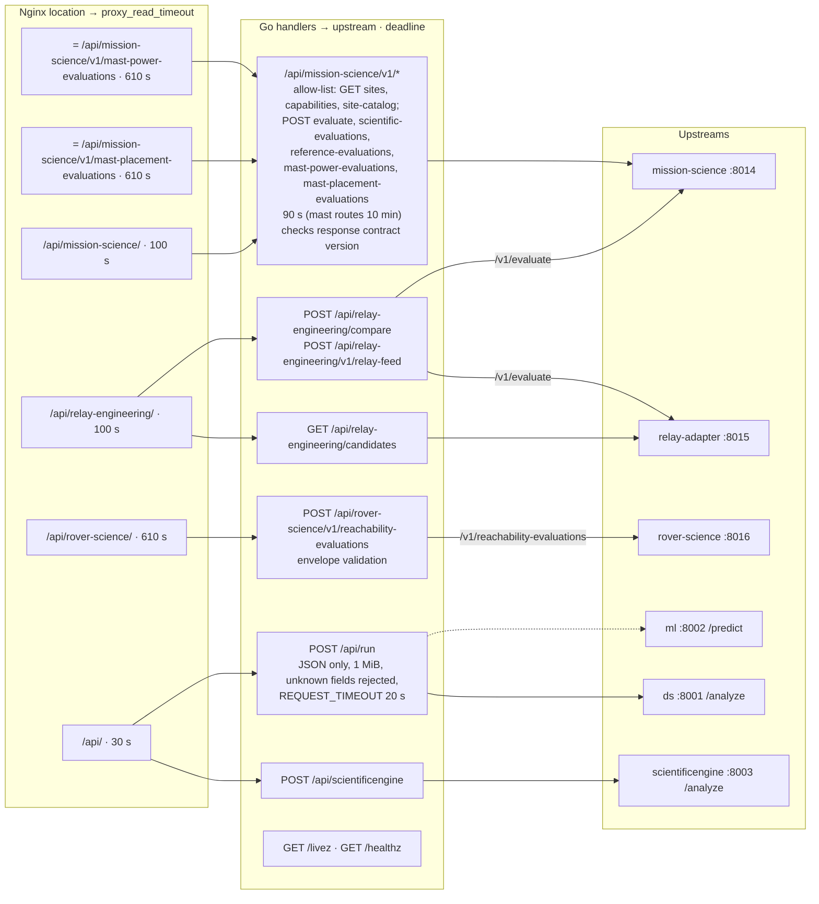

## 5. Live check: scientific evaluation

`frontend/src/components/planner/LiveCheck.tsx` → `src/lib/missionScience.ts` / `scientificContract.ts`. Since commit `ae61eff`, an answer that arrives after its run was cancelled is dropped.

The request carries `localResolutionM`, which picks the terrain: 80 for the south-pole sites, 1895.21 for every other site ([section 14](#14-site-routing-polar-or-global-terrain)). The per-site reference page (`/analyze/$siteId`, `components/dynamicSiteReference.tsx`) follows the same path through `src/lib/referenceScience.ts`, but posts to `/v1/reference-evaluations` for one UTC day at a time, and fills the year one day after another in the background.

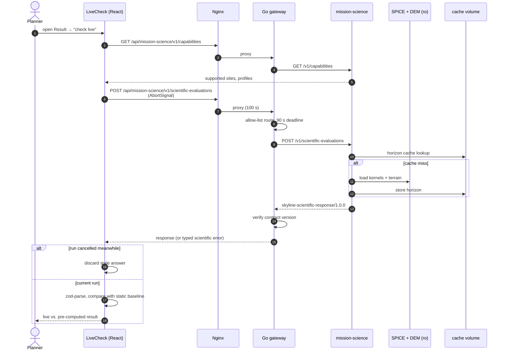

## 6. Relay comparison (Go orchestrates two services)

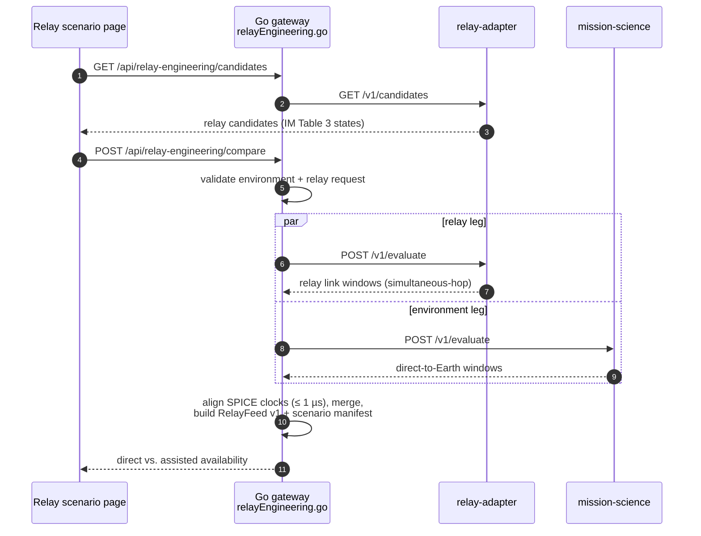

## 7. Mast power and placement (long-running)

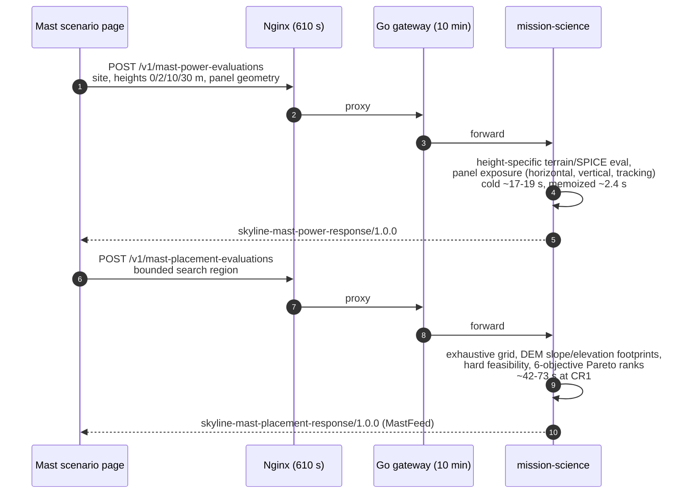

## 8. Rover reachability

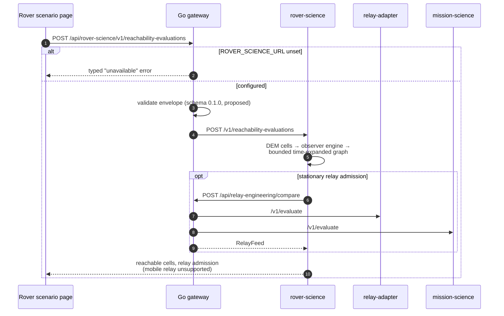

## 9. Scenario feed lifecycle

Feeds are computed once by a live service, written as immutable, content-addressed files, and then served statically.

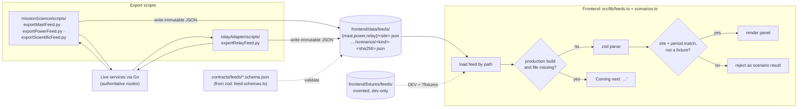

## 10. Frontend structure

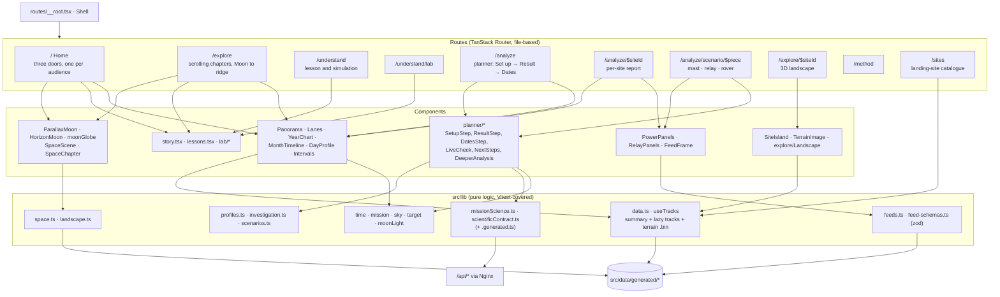

## 11. Contracts and schema flow

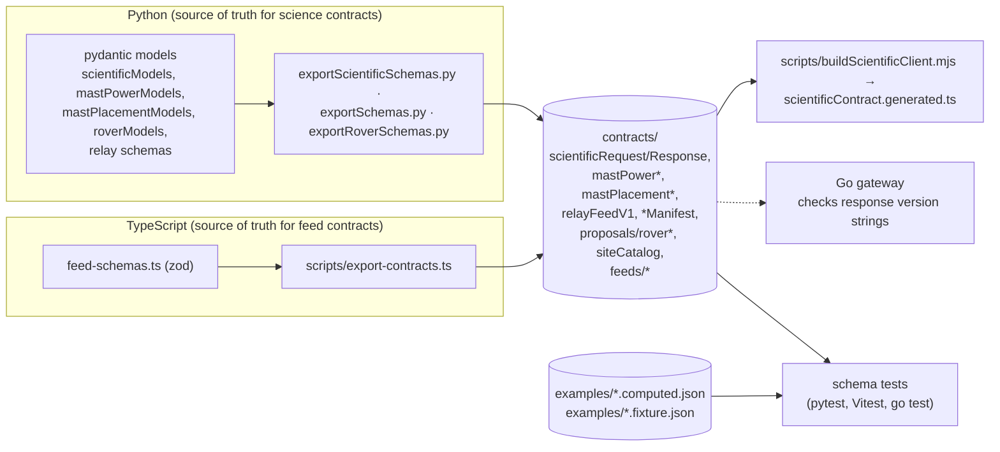

## 12. Deployment: Compose services, volumes, profiles

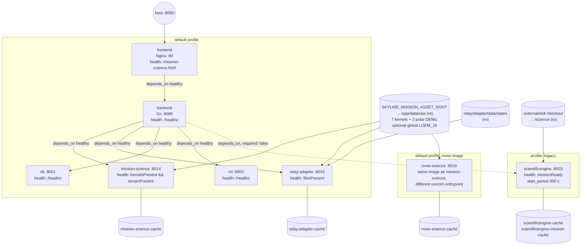

## 13. Planner user journey

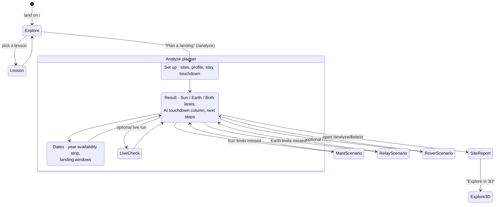

## 14. Site routing: polar or global terrain

The catalogue decides how each site is computed. `frontend/data/catalogue/sites.json` (13 sites, exported from `services/missionScience/src/skyline_mission_science/siteCatalog.json` by `exportSiteCatalogue.py`) gives every site a `liveEvaluation` status and a `terrainResolutionM`. The `/sites` page lists them, and `src/lib/missionScience.ts` turns them into requests.

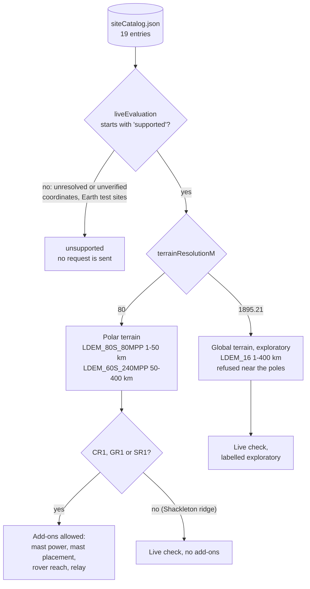

| Group | Sites | Terrain | What runs |
| --- | --- | --- | --- |
| Study sites | Connecting Ridge (CR1), de Gerlache Rim (GR1), Shackleton Rim (SR1) | 80 m polar | Precomputed year, live check, every add-on |
| Polar comparison | Shackleton connecting ridge | 80 m polar | Precomputed year, live check |
| Apollo 11 | Apollo 11, Tranquility Base | 118 m global for the year, 1.9 km global for live checks | Precomputed year, live check |
| Other agencies' landings | Chang'e-4 (LROC 2019), Chang'e-6, SLIM (LROC 2024), Luna-25 impact | 118 m global for the year, 1.9 km global for live checks | Precomputed year, live check labelled exploratory |
| Other agencies' landings near 69°S | Chandrayaan-3, Luna-25 target | 60 m and 240 m polar for the year, 1.9 km global for live checks | Precomputed year, live check labelled exploratory |
| Unresolved | Chang'e-4 (Liu 2019), SLIM (PGDA surface coordinate) | none | Listed with the reason, never computed |

The table's "for the year" terrain is the offline pipeline's (`ds/pipeline/moon.py`, `terrain_for`): the 20 m to 240 m polar maps poleward of 75°S, the 60 m polar map to 100 km and the 240 m map to 200 km between 60° and 75°S, and the 118 m global map elsewhere, read across the ±180° seam when a site needs it.

The engine itself switches on the request's `localResolutionM` (`engine.py:52-57`), not on the site. The add-on services enforce their own limits: mast power, mast placement and rover reach refuse any site outside CR1, GR1 and SR1, and accept only 20 or 80 m terrain. [docs/science/engine.md](../science/engine.md) describes the calculation on each kind of terrain.
