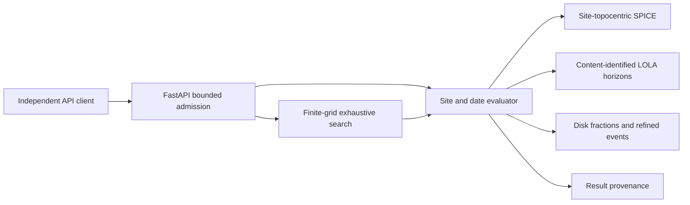

# Architecture

One scientific operation owns the process-global SPICE pool at a time. The API admits one POST request and rejects concurrent work without queuing. Comparisons contain at most 16 evaluations. Search contains at most 128 declared scenario evaluations. Results use a bounded 32-entry in-process cache whose keys include all request parameters and actual asset content hashes. Horizon persistence uses atomic replacement and asset content identity. Kernel calls and terrain construction are synchronous.

The package has no imports from the INT-4 checkout or the application. Its terrain implementation adapts selected INT-4 modules (see source-provenance.md). Nothing outside this package is a dependency of the running service.
