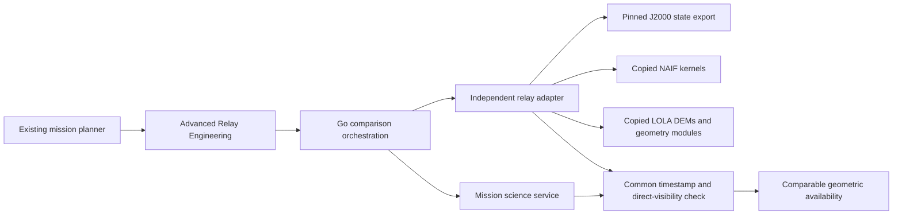

# Relay adapter architecture

The original repository remains a read-only provenance source. The adapter has its own source package, environment, trajectory, kernels, DEMs and cache. Selected modules are copied under legacy with original headers. The terrain cache identity was adapted to include actual content hashes. The source manifest preserves original revisions and SHA-256 identities.

The adapter serializes scientific evaluations with a nonblocking lock and returns busy without queuing. Inputs are bounded to 4096 bytes. Replay evaluation has at most 20160 timestamps and two relays. Memory peak is unmeasured. Go comparisons are limited to one day and have a 90 s evaluation deadline. The nginx comparison route has a matching longer timeout.

The application adds /api/relay-engineering/candidates and /api/relay-engineering/compare. Existing mission and INT-4 routes retain their endpoints. Mission-science provenance adds observerPositionM so the orchestration can verify actual observer geometry. The new schema is delivered independently from frozen INT-4 contracts.
